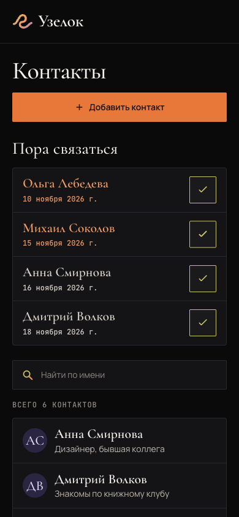
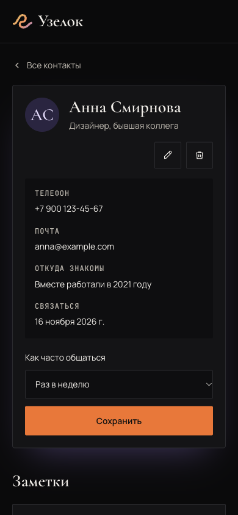

# keep-in-touch Specification

## Purpose

Помогает не терять связь с людьми: задавать желаемую частоту общения и видеть на главной всех просроченных и до двух ближайших запланированных контактов.

## Requirements

### Requirement: Необязательная частота общения

Приложение MUST позволять непосредственно в карточке контакта задать, изменить или убрать частоту общения. Доступные значения: раз в неделю, месяц, квартал, год или без заданной частоты. У новых и существующих контактов частота MUST оставаться незаданной, пока пользователь её не выберет.

#### Scenario: Выбор частоты в карточке
- **WHEN** пользователь открывает карточку контакта без заданной частоты
- **THEN** он может сохранить один из четырёх периодов прямо в карточке
- **AND** сохранённое значение остаётся после обновления страницы и при открытии карточки в другом браузере

#### Scenario: Контакт без настройки
- **WHEN** у контакта частота общения не задана
- **THEN** у него нет запланированной даты контакта, и он не попадает в «Пора связаться»

#### Scenario: Подпись кнопки настройки
- **WHEN** в карточке контакта частота ещё не задана
- **THEN** кнопка сохранения называется «Задать частоту»
- **AND** после успешного сохранения периода кнопка называется «Изменить частоту»
- **AND** после успешного снятия частоты кнопка снова называется «Задать частоту»
- **AND** несохранённый выбор в меню и ошибка сохранения не меняют подпись, которая соответствует сохранённой настройке

#### Scenario: Снятие настройки
- **WHEN** пользователь убирает ранее заданную частоту и успешно сохраняет настройку
- **THEN** запланированная дата очищается, и контакт исчезает из блока «Пора связаться»
- **AND** контакт и его заметки сохраняются

### Requirement: Запланированная дата в карточке

При заданной частоте приложение MUST показывать строку «Связаться» в информационном блоке карточки контакта. Строка MUST содержать сохранённую следующую дату по Новосибирску без часов и минут, рассчитанную по текущей частоте. При отсутствии частоты строка MUST отсутствовать.

#### Scenario: Карточка с расписанием
- **WHEN** пользователь открывает карточку контакта с заданной частотой
- **THEN** в блоке информации видна строка «Связаться» с запланированной датой
- **AND** дата совпадает с датой этого контакта в блоке на главной, если он там показан

#### Scenario: Изменение расписания в карточке
- **WHEN** пользователь успешно сохраняет частоту или новую заметку
- **THEN** строка «Связаться» показывает актуальную следующую дату
- **AND** несохранённый выбор частоты не меняет показанную дату

#### Scenario: Отсутствие или снятие частоты
- **WHEN** частота не задана или пользователь успешно снимает её
- **THEN** строка «Связаться» в информационном блоке отсутствует

### Requirement: Фиксированные периоды

Приложение MUST считать неделю как 7 суток, месяц как 30 суток, квартал как 90 суток и год как 365 суток. Сутки MUST соответствовать 24 часам; календарная длина месяца или года не меняет период.

#### Scenario: Расчёт каждого периода
- **WHEN** начинается новый срок для контакта с выбранной частотой
- **THEN** запланированная дата равна моменту начала срока плюс 7, 30, 90 или 365 полных суток соответственно

#### Scenario: Переход через короткий месяц
- **WHEN** пользователь задаёт общение раз в месяц 1 февраля 2027 года в 18:00 по Новосибирску
- **THEN** следующая дата контакта — 3 марта 2027 года в 18:00 по Новосибирску

### Requirement: Начало срока при настройке

При каждом успешном сохранении частоты, включая повторное сохранение того же значения, приложение MUST начинать новый срок с момента сохранения. Дата создания контакта и прежние заметки MUST NOT определять начало этого срока. Сохранение настройки MUST NOT создавать заметку об общении.

#### Scenario: Первый выбор без заметок
- **WHEN** пользователь сохраняет недельную частоту 16 ноября 2026 года в 18:00 по Новосибирску для контакта без заметок
- **THEN** следующая дата контакта — 23 ноября 2026 года в 18:00 по Новосибирску независимо от даты создания контакта

#### Scenario: Первый выбор при наличии старых заметок
- **WHEN** пользователь впервые сохраняет частоту для контакта со старыми заметками
- **THEN** новый срок начинается с момента сохранения настройки, а не с последней старой заметки

#### Scenario: Смена периода
- **WHEN** пользователь меняет недельную частоту на месячную и успешно сохраняет её
- **THEN** следующая дата назначается через 30 суток от этого сохранения, а прежний срок заменяется

#### Scenario: Повторное включение
- **WHEN** пользователь задаёт частоту заново после её снятия
- **THEN** срок начинается с нового сохранения, а прежняя дата не восстанавливается

#### Scenario: Повторное сохранение той же частоты
- **WHEN** пользователь повторно сохраняет уже выбранную недельную частоту
- **THEN** следующий срок назначается через 7 суток от нового сохранения, даже если значение частоты не изменилось
- **AND** новая заметка об общении не появляется

### Requirement: Перенос срока новой заметкой

Каждая успешно сохранённая новая заметка MUST считаться общением и начинать срок заново от момента её сохранения с текущей выбранной частотой. Без заданной частоты заметка MUST NOT создавать расписание. Изменение имени и других данных контакта MUST NOT переносить срок.

#### Scenario: Заметка для контакта с частотой
- **WHEN** пользователь успешно добавляет заметку контакту с недельной частотой 16 ноября 2026 года в 18:00 по Новосибирску
- **THEN** следующая дата — 23 ноября 2026 года в 18:00 по Новосибирску
- **AND** прежняя запланированная дата заменяется независимо от того, была ли она просрочена

#### Scenario: Несколько последовательных заметок
- **WHEN** пользователь сохраняет несколько новых заметок для контакта с заданной частотой
- **THEN** срок отсчитывается от последней успешно сохранённой заметки

#### Scenario: Заметка без частоты
- **WHEN** пользователь добавляет заметку контакту без заданной частоты
- **THEN** заметка сохраняется, но запланированная дата не появляется

#### Scenario: Обычное редактирование контакта
- **WHEN** пользователь изменяет имя, описание, телефон, почту или сведения о знакомстве
- **THEN** частота и запланированная дата контакта не меняются

### Requirement: Кнопка быстрой отметки общения

Приложение MUST показывать отдельную кнопку с галочкой «Связались» у каждого контакта в блоке «Пора связаться» на главной. В карточке контакта эта кнопка MUST отсутствовать. Кнопка MUST иметь понятное доступное имя, поддерживать клавиатуру и быть отдельной от ссылки в карточку. После нажатия пользователь MUST оставаться на текущей странице.

#### Scenario: Галочка в строке блока
- **WHEN** пользователь нажимает галочку у просроченного или ближайшего контакта в «Пора связаться»
- **THEN** общение отмечается для выбранного контакта, а главная остаётся открытой
- **AND** нажатие на имя этого контакта отдельно открывает его карточку

#### Scenario: Карточка контакта
- **WHEN** пользователь открывает карточку контакта с заданной или незаданной частотой
- **THEN** галочка «Связались» не показана
- **AND** общение можно записать новой заметкой, а частоту — задать или изменить отдельной формой

#### Scenario: Отметка с клавиатуры и на телефоне
- **WHEN** пользователь выбирает кнопку с галочкой клавиатурой или нажимает её на мобильном экране
- **THEN** можно отметить общение без случайного перехода в карточку
- **AND** доступное имя кнопки объясняет действие и указывает выбранного человека

### Requirement: Автоматическая заметка при быстрой отметке

Успешное нажатие «Связались» MUST добавлять заметку «Связались» с точной датой и временем отметки, сохраняя дату последнего общения. Если частота задана, приложение MUST начинать новый срок от этого момента. Без частоты MUST сохраняться только заметка, без создания расписания. Автоматическая заметка MUST быть видна среди обычных заметок контакта.

#### Scenario: Отметка просроченного контакта
- **WHEN** пользователь успешно нажимает «Связались» у контакта с недельной частотой 16 ноября 2026 года в 18:00 по Новосибирску
- **THEN** создаётся одна заметка «Связались» с моментом отметки, а следующий срок — 23 ноября 2026 года в 18:00
- **AND** контакт больше не просрочен, а на экране следующего контакта видна только дата «23 ноября 2026»

#### Scenario: Отметка ближайшего будущего контакта
- **WHEN** пользователь отмечает общение с контактом, чей прежний срок ещё не прошёл
- **THEN** прежний срок заменяется сроком от новой отметки с текущей частотой, а в карточке появляется заметка «Связались»

#### Scenario: Общение без расписания
- **WHEN** частота снята в другой вкладке, а пользователь нажимает «Связались» в ранее загруженном блоке на главной
- **THEN** сохраняется заметка «Связались» с датой последнего общения
- **AND** частота и запланированная дата остаются незаданными, а контакт не появляется в «Пора связаться»

#### Scenario: Ручные и автоматические заметки
- **WHEN** после быстрой отметки пользователь сохраняет обычную заметку либо после обычной заметки нажимает «Связались»
- **THEN** дата последнего общения соответствует последней успешно сохранённой заметке независимо от способа добавления
- **AND** при заданной частоте следующий срок отсчитывается от неё

### Requirement: Граница просрочки

Контакт MUST считаться просроченным только после наступления запланированного момента. До этого момента и в точный момент срока контакт MUST относиться к ближайшим запланированным. При следующей загрузке главной приложение MUST определять статус по текущему времени.

#### Scenario: Перед сроком
- **WHEN** следующая дата — 23 ноября 2026 года в 18:00 по Новосибирску, а текущее время ещё раньше
- **THEN** контакт ещё не просрочен

#### Scenario: Точный момент срока
- **WHEN** текущее время в точности совпадает с запланированным моментом
- **THEN** контакт ещё относится к ближайшим запланированным

#### Scenario: Срок прошёл
- **WHEN** главная загружается после 23 ноября 2026 года в 18:00 по Новосибирску для контакта с такой запланированной датой
- **THEN** контакт относится к просроченным независимо от часового пояса устройства

#### Scenario: Сегодняшняя дата после точного срока
- **WHEN** следующий срок был сегодня в 10:00 по Новосибирску, а главная загружается сегодня в 12:00
- **THEN** контакт выделен как просроченный, хотя видна только сегодняшняя дата без часов

### Requirement: Все просроченные контакты

Блок «Пора связаться» MUST находиться на главной над общим списком и показывать всех просроченных контактов первыми, без ограничения их количества. Сортировка MUST идти по времени сверх запланированного срока: чем больше просрочка, тем выше контакт независимо от выбранной частоты.

#### Scenario: Просроченных больше двух
- **WHEN** пять контактов просрочены
- **THEN** все пять показаны в блоке от самой ранней пропущенной даты к самой поздней

#### Scenario: Разные частоты
- **WHEN** у контакта с ежегодным общением просрочка 30 суток, а у контакта с еженедельным — 5 суток
- **THEN** первым показан контакт с просрочкой 30 суток

### Requirement: Два ближайших запланированных контакта

После просроченных блок MUST показывать до двух контактов, чей срок ещё не прошёл, по ближайшей запланированной дате. Ограничение в два MUST применяться только к этой части блока, а не к просроченным. Каждый контакт MUST появляться в блоке не больше одного раза.

#### Scenario: Несколько будущих дат
- **WHEN** есть четыре контакта с ещё не наступившими датами и нет просроченных
- **THEN** блок показывает только два контакта с самыми близкими датами в порядке их наступления

#### Scenario: Меньше двух будущих контактов
- **WHEN** есть один контакт с будущей датой
- **THEN** показан только этот будущий контакт, без пустого второго места

#### Scenario: Просроченные вместе с будущими
- **WHEN** есть пять просроченных и три будущих контакта
- **THEN** блок содержит семь разных контактов: все пять просроченных, затем два ближайших будущих

#### Scenario: Только просроченные
- **WHEN** есть просроченные контакты и ни одного будущего
- **THEN** показаны все просроченные без пустых мест для будущих

### Requirement: Содержимое записи и дата Новосибирска

Запись в блоке MUST показывать имя контакта, его запланированную дату по Новосибирску без часов и минут и отдельную кнопку с галочкой «Связались». Приложение MUST NOT показывать время следующего контакта или число дней просрочки. Нажатие на имя и дату MUST открывать карточку; галочка MUST только отмечать общение.

#### Scenario: Просмотр записи
- **WHEN** контакт попал в блок «Пора связаться»
- **THEN** видны имя, запланированная дата без времени и кнопка с галочкой, без телефона, описания, частоты и числа дней просрочки
- **AND** имя и дата открывают карточку, а галочка отмечает общение на главной

#### Scenario: Другой часовой пояс устройства
- **WHEN** тот же блок открывают на устройстве с другим часовым поясом
- **THEN** видна та же запланированная дата по Новосибирску без часов и минут

**Мобильный дизайн**

[Открыть мобильный макет 390 × 844](../../changes/archive/2026-11-13-keep-in-touch/design/mobile.html). Данные в макете вымышленные; действия показывают сценарий без сохранения в настоящую базу. Запланированный контакт отображается только датой, кнопки с галочкой доступны в строках блока на главной.

**Главная**

**Карточка**

### Requirement: Цветовое различие статусов

Приложение MUST выделять просроченные записи цветом, отличным от записей с ещё не прошедшим сроком. Имя и дата MUST оставаться читаемыми на мобильном и широком экране.

#### Scenario: Два статуса в одном блоке
- **WHEN** блок содержит просроченные и ближайшие запланированные контакты
- **THEN** просроченные визуально отличаются от ближайших запланированных цветом

#### Scenario: Мобильный экран и длинное имя
- **WHEN** блок просматривают на мобильном экране с контактом, у которого длинное имя
- **THEN** имя и запланированная дата остаются доступными для чтения, карточку можно открыть, а отдельную галочку — нажать

### Requirement: Независимость от поиска

Поиск по имени MUST фильтровать только общий список контактов. Состав, порядок и наличие блока «Пора связаться» MUST NOT зависеть от поискового запроса.

#### Scenario: Поиск другого человека
- **WHEN** пользователь вводит имя, которое не совпадает ни с одним контактом в «Пора связаться»
- **THEN** общий список фильтруется по запросу, а блок сохраняет всех своих просроченных и до двух ближайших запланированных контактов

#### Scenario: Поиск ничего не нашёл
- **WHEN** поиск по имени не находит контактов
- **THEN** общий список показывает своё пустое состояние, а блок «Пора связаться» остаётся общим

### Requirement: Нет запланированных контактов

Когда нет ни просроченных, ни ближайших запланированных контактов, приложение MUST сохранять блок «Пора связаться» и показывать сообщение «Пока нет запланированных контактов».

#### Scenario: Расписание никому не задано
- **WHEN** ни у одного контакта нет заданной частоты или список контактов пуст
- **THEN** блок показывает сообщение «Пока нет запланированных контактов»

#### Scenario: Просроченных нет, но будущие есть
- **WHEN** просроченных контактов нет, но есть будущие
- **THEN** вместо сообщения показаны до двух ближайших будущих контактов

### Requirement: Согласованное сохранение и ошибки

Приложение MUST менять запланированную дату только после успешного сохранения частоты, ручной заметки или отметки «Связались». Автоматическая заметка и перенос срока MUST сохраняться вместе. При ошибке MUST оставаться прежние данные, отображаться ошибка и сохраняться возможность повтора. Отсутствующий контакт MUST сообщаться как не найденный.

#### Scenario: Частоту не удалось сохранить
- **WHEN** сохранение новой частоты завершается ошибкой
- **THEN** прежняя частота и запланированная дата сохраняются, показана ошибка и можно повторить сохранение

#### Scenario: Заметку не удалось сохранить
- **WHEN** новая заметка пуста, не проходит проверку или её сохранение завершается ошибкой
- **THEN** запланированная дата не переносится, заметка не появляется, а пользователь видит ошибку и может исправить или повторить ввод

#### Scenario: Контакт исчез перед сохранением
- **WHEN** пользователь сохраняет частоту, заметку или отметку «Связались» уже удалённого контакта
- **THEN** приложение сообщает, что контакт не найден, и не показывает успешное сохранение

#### Scenario: Ожидание быстрой отметки
- **WHEN** запрос «Связались» для контакта ещё выполняется
- **THEN** его кнопка показывает ожидание и не позволяет повторно отправить запрос с этой страницы
- **AND** одно нажатие не создаёт несколько автоматических заметок

#### Scenario: Ошибка быстрой отметки
- **WHEN** сохранение «Связались» завершается ошибкой на главной
- **THEN** автоматическая заметка не появляется, срок и дата последнего общения остаются прежними
- **AND** пользователь остаётся на странице, видит ошибку и может повторить попытку

#### Scenario: Сохранение черновика заметки
- **WHEN** в карточке введён черновик заметки, а пользователь успешно сохраняет частоту
- **THEN** введённый черновик остаётся в поле без изменений

### Requirement: Актуальность после изменений

После успешного изменения частоты, добавления заметки или отметки «Связались» приложение MUST показывать актуальные дату и положение контакта в блоке. Галочка на главной MUST обновлять блок сразу после успеха. После удаления контакт MUST отсутствовать в блоке, а его место среди ближайших MUST занимать следующий подходящий контакт при наличии.

#### Scenario: Заметка просроченному контакту
- **WHEN** пользователь успешно добавил заметку просроченному контакту и вернулся на главную
- **THEN** контакт больше не просрочен и показывается среди будущих только если входит в два ближайших

#### Scenario: Период изменён
- **WHEN** пользователь изменил частоту и вернулся на главную
- **THEN** блок использует новую запланированную дату и пересчитывает состав двух ближайших

#### Scenario: Обновление блока после галочки
- **WHEN** пользователь успешно отметил общение галочкой в блоке на главной
- **THEN** главная остаётся открытой и сразу показывает пересчитанный блок
- **AND** отмеченный контакт находится среди будущих только если входит в два ближайших, а освободившееся место занимает следующий подходящий контакт

#### Scenario: Просмотр заметки после галочки
- **WHEN** пользователь успешно нажал галочку на главной и открыл карточку этого контакта
- **THEN** карточка показывает новую автоматическую заметку
- **AND** при возврате на главную используются актуальный срок и положение контакта

#### Scenario: Удаление контакта из блока
- **WHEN** пользователь успешно удаляет показанный в блоке контакт и возвращается на главную
- **THEN** удалённого контакта в блоке нет
- **AND** если он был среди ближайших, его место занимает следующий ближайший будущий контакт при наличии такого
